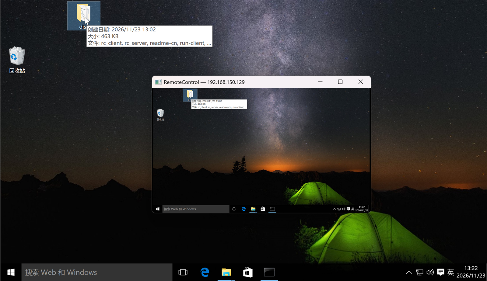
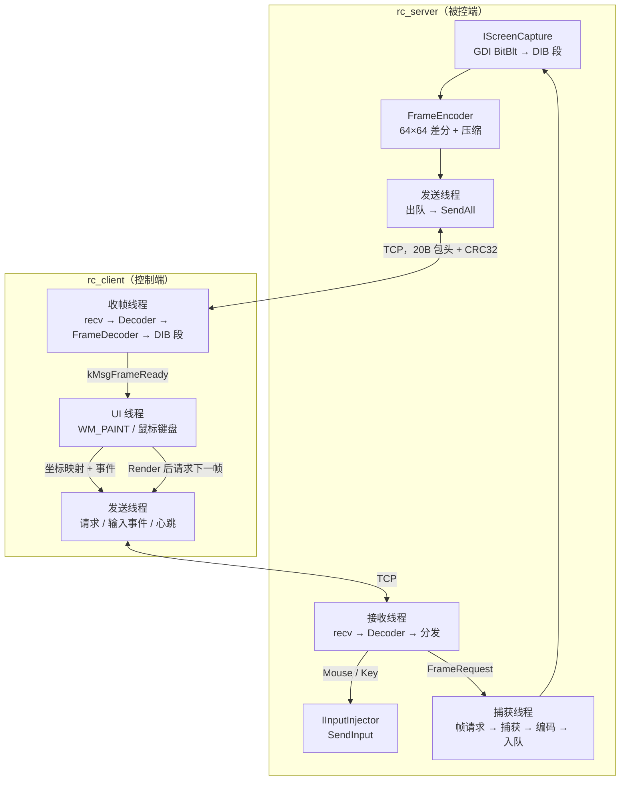
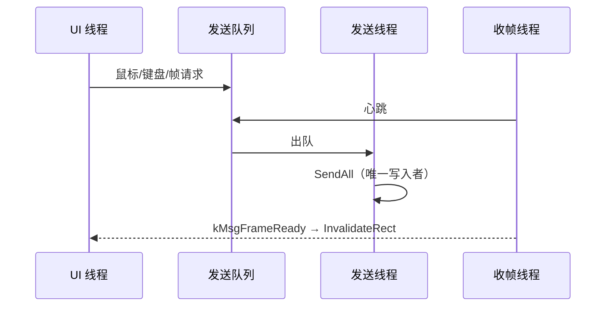

# RemoteControl — 基于 C++20 / Win32 的局域网远程桌面

自研二进制协议 + 分块脏矩形增量的屏幕传输，配合解耦的输入注入流水线。



> 实际部署形态：`rc_server` 跑在虚拟机里，`rc_client` 跑在宿主机，窗口标题栏是 VM 的 IP。窗口里显示的就是虚拟机的桌面，鼠标键盘实时转发过去。

---

## 目录

- [1. 这个项目解决什么问题](#1-这个项目解决什么问题)
- [2. 关键设计](#2-关键设计)
- [3. 架构](#3-架构)
- [4. 协议设计](#4-协议设计)
- [5. 帧编码：分块差分 + 压缩](#5-帧编码分块差分--压缩)
- [6. 线程模型](#6-线程模型)
- [7. 构建与运行](#7-构建与运行)
- [8. 测试](#8-测试)
- [9. 性能数据](#9-性能数据)
- [10. 演示环境建议：服务端放虚拟机](#10-演示环境建议服务端放虚拟机)
- [11. v1 → v2 修掉了什么](#11-v1--v2-修掉了什么)
- [12. 已知限制与下一步](#12-已知限制与下一步)
- [13. 目录结构](#13-目录结构)

---

## 1. 这个项目解决什么问题

一个局域网内的远程桌面：服务端抓屏并把画面编码后发给客户端，客户端显示并把鼠标/键盘事件回传，服务端用 `SendInput` 重放。

第一版能跑通，但**每次请求都把整屏截下来编码成 PNG 再整包发送**——1080p 下每帧 300KB~2MB，帧率被"全屏 PNG 编码"卡死在个位数。第二版重做了传输模型和协议层：

| 指标（1920×1080 合成桌面，见第 9 节） | v1（整帧 PNG） | v2（分块差分 + 压缩） |
|:--|--:|--:|
| 平均每帧字节 | 1716 KB | **108 KB**（6.3%） |
| 平均编码耗时 | 56.6 ms | **3.1 ms** |
| 单核编码上限 | 17.7 fps | **322 fps** |
| 画面完全静止时 | 一样贵 | **24 B/帧** |

代价是代码量翻了几倍，以及必须自己处理流式解包、重同步、脏块边界和压缩算法协商。

---

## 2. 关键设计

- **流式协议状态机**，不是"扫描魔数"。包头定长 20 字节 + CRC32 校验，正常路径 O(1)，只有校验失败时才滑动重同步。半包、粘包、脏字节都是显式分支，有单元测试覆盖。
- **分块脏矩形增量**：画面切成 64×64 块，逐块 `memcmp` 差分，只编码变化的块；上一帧缓冲只更新脏块，不整屏拷贝。
- **压缩算法可切换**：`XPRESS_HUFF`（快）与 `MSZIP`（省带宽）都实测过，算法写进包头标志位，收端按标志位解压，两者互通，不做版本锁死。
- **单一 socket 写入者**：所有出站数据都过一条队列，由发送线程独占写入；客户端 UI 线程只投递、从不碰 socket。
- **按客户端窗口尺寸协商降采样**：把 2560×1600 的桌面原样传给 1024 宽的窗口，等于白传 6 倍像素。
- **捕获与注入都是接口**（`IScreenCapture` / `IInputInjector`），换 DXGI 后端不需要动协议和会话层。

---

## 3. 架构



请求-响应是**锁步**的：客户端画完一帧才请求下一帧，天然形成背压，服务端不需要猜客户端能消费多少。

---

## 4. 协议设计

### 4.1 包头（20 字节，`#pragma pack(1)`）

```
+----------+---------+---------+------------+-----------+-----------+
| magic 4B | cmd 2B  | flags2B | body_len4B | seq 4B    | crc32 4B  |
| 'RCV2'   |         |         |            |           | body 校验 |
+----------+---------+---------+------------+-----------+-----------+
```

`crc32` 覆盖包体，`seq` 每方向独立自增。有了定长头和校验，解包器可以**按状态推进**：

```
等待包头(20B) → 校验 magic / body_len 上限 → 等待包体(body_len) → 校验 CRC32 → 交付
        ↓ 任一步失败
   滑过 1 字节，重新寻找下一个合法包头（重同步）
```

旧版是把缓冲区丢给 `ParsePacket` 扫魔数，但返回的包**不带偏移量**，调用方一律假设包头在 `buffer[0]`；一旦出现脏字节，`memmove` 的步长和实际消费量不一致，整条流永久错位且无法恢复。这个 bug 在 v2 里被彻底消掉了。

### 4.2 命令

| 值 | 名称 | 方向 | 说明 |
|--:|:--|:--|:--|
| 1 | `kHello` | C→S | 版本、口令哈希、客户端可显示尺寸 |
| 2 | `kHelloAck` | S→C | 帧尺寸、降采样倍数、虚拟桌面原点 |
| 3 | `kFrameRequest` | C→S | 空包体 |
| 4 | `kFrame` | S→C | 帧头 + 分块表 + 像素 |
| 5 | `kMouse` | C→S | 动作 + 滚轮增量 + 绝对坐标 |
| 6 | `kKey` | C→S | 虚拟键码 + 扫描码 + 按下/抬起 |
| 7 / 8 | `kPing` / `kPong` | 双向 | 2 秒心跳，8 秒无流量判定断线 |
| 9 | `kBye` | 双向 | 版本不匹配 / 口令错误 / 协议错误 |

### 4.3 为什么用 TCP

屏幕帧必须完整到达才有意义，UDP 上要自己做重传 + 重排序，工作量远大于它带来的延迟收益；局域网 RTT 在 1ms 量级，锁步请求-响应的往返开销可以忽略。真正的延迟来源是**编码耗时**而不是协议栈——第 9 节的数据能证明这一点。

---

## 5. 帧编码：分块差分 + 压缩

### 5.1 帧体布局

```
FrameHead (24B)
├── frame_id, screen_w/h, tile_size, tiles_x/y
├── tile_count          // 0 表示"画面无变化"，此时整个帧体只有 24 字节
├── cursor_x/y, cursor_visible
└── key_frame           // 1 = 所有分块都是脏块

TileEntry × tile_count (10B each)
├── tile_index          // = ty * tiles_x + tx
├── width, height
└── data_len

像素数据（按分块表顺序紧密排列，BGRA8888）
```

### 5.2 编码流程

1. `BitBlt` 到一个复用的小端 DIB 段（不是每帧新建 DC/位图）；
2. 逐块与上一帧 `memcmp`，记录脏块；
3. 只把脏块的像素搬进帧体；
4. 帧体整体压缩，只有压缩后真的更小才替换并打标志位；
5. 上一帧缓冲只更新脏块，避免每帧 8MB 全量拷贝。

### 5.3 为什么按块而不是按行/按像素

- 按像素：差分最精确，但索引开销（每像素几个字节）会把收益吃掉；
- 按行：一行里改一个像素就得重传 8KB；
- 64×64：一块 16KB，压缩器有足够上下文；块表开销 10B/块，1080p 满屏也只有 5KB。

分块粒度是 `--tile` 可调的（16~256），默认 64。

---

## 6. 线程模型

### 6.1 服务端：三流水线

| 线程 | 职责 |
|:--|:--|
| 接收线程 | `recv` → `Decoder` → 分发：鼠标/键盘直接注入，帧请求置位条件变量 |
| 捕获线程 | 等帧请求 → 捕获 → 差分编码 → 压缩 → 入发送队列 |
| 发送线程 | 出队 → `SendAll`，**socket 的唯一写入者** |

### 6.2 客户端：读写分离

UI 线程和收帧线程都**不直接写 socket**：所有出站数据塞进 `BlockingQueue`，由发送线程独占写入。

这是 v1 最严重的 bug 修复：v1 里 UI 线程发鼠标/键盘、收屏线程发帧请求，**两个线程同时对同一个 socket 调 `send` 且完全无锁**，TCP 字节流会交错。现在 `SendAll` 内部还有一层互斥兜底。



### 6.3 为什么不用 `PostThreadMessage`

v1 用 `CreateThread` + `PostThreadMessage` 给三个工作线程派活，问题有三个：

1. 线程的消息队列在首次 `GetMessage` 前不存在，`Post` 会静默失败——v1 靠 `Sleep(100)` 赌；
2. 没有背压能力，只能无限堆积；
3. 指针通过 `lParam` 跨线程传递，所有权靠约定，容易漏 `free`。

v2 换成 `std::thread` + `std::condition_variable` + 有界队列：所有权明确（`std::vector` 移动），队列满时明确丢帧并计数。

### 6.4 三个让鼠标"发涩"的坑

远程桌面里"鼠标延迟"往往不是网络问题。这一版踩到并修掉的有三个：

| 问题 | 现象 | 修法 |
|:--|:--|:--|
| 鼠标事件映射要抢 `paint_mutex_`，而收帧线程解码整帧时长时间持有它 | 每次移鼠标都要等当前帧解码完，手感一顿一顿 | 把表面尺寸 / 原点 / 缩放全部用原子量发布，映射路径**完全不加锁** |
| 每次 `WM_PAINT` 都发一条帧请求；窗口重绘抖动时把服务端打成一帧接一帧满负荷编码 | 服务端 CPU 打满，帧反而更慢 | 请求-响应锁步 + `frame_pending_` 标志，同一时刻最多一条请求在途（1 秒兜底） |
| 客户端在画面上叠加"远端光标" | 本机指针是即时的，叠加的那个要等下一帧才动，视觉上就是"鼠标在追" | 默认不画。`--show-cursor` 可选打开 |

第三条要展开说一句：GDI `BitBlt` 抓屏**不包含光标**，所以远端画面里本来就没有指针。客户端窗口上显示的是**本机的系统光标**，它已经在正确的位置了；再叠一个"远端光标"只会让人看到两个箭头，而其中慢的那个会立刻被大脑判定成"卡"。关掉之后同样的网络条件下手感会好很多。

---

## 7. 构建与运行

### 7.1 环境

| 项 | 要求 |
|:--|:--|
| 构建机 OS | Windows 10 / 11 x64 |
| 构建机编译器 | Visual Studio 2022 或 2026（MSVC v143/v145），C++20 |
| 构建 | CMake ≥ 3.20 |
| 依赖 | 仅系统库：`ws2_32` `cabinet` `user32` `gdi32` |
| **目标机** | **Windows 10 x64 及以上，不需要装任何运行时** |

没有第三方依赖。压缩用的是 Windows 自带的 Compression API（`CABINET.LIB`）。默认静态链接 C 运行库，产物可以直接拷到干净的机器上跑，见 7.6。

### 7.2 构建

```powershell
cmake -S . -B build -A x64
cmake --build build --config Release
```

也可以直接用 Visual Studio 打开仓库根目录（VS 会读取 `CMakeLists.txt`）。

产物在 `build\Release\`：`rc_server.exe`、`rc_client.exe`（GUI 子系统）、`rc_tests.exe`、`rc_bench.exe`。

### 7.3 运行

**被控端**：

```powershell
.\build\Release\rc_server.exe --port 9999 --token mysecret --verbose
```

**控制端**：

```powershell
.\build\Release\rc_client.exe --host 192.168.1.10 --port 9999 --token mysecret
```

客户端窗口会同步显示远端桌面；鼠标拖动、滚轮、键盘输入都会转发过去。断线后自动重连（1 秒退避）。

服务端是控制台程序，输出走 `WriteConsoleW`（UTF-16），**不需要 `chcp 65001`，中文 Windows 的 GBK 控制台也不会乱码**；输出被重定向到文件/管道时则按 UTF-8 写。

### 7.4 参数

`rc_server`

| 参数 | 默认 | 说明 |
|:--|:--|:--|
| `--port <n>` | 9999 | 监听端口 |
| `--token <s>` | 空 | 连接口令；为空时只打印警告，不校验 |
| `--scale <n>` | 1 | 强制降采样 1~4 倍；实际值取 `max(--scale, 由客户端窗口推出的倍数)` |
| `--codec <name>` | `auto` | `auto` / `huff`（快）/ `mszip`（省带宽） |
| `--tile <n>` | 64 | 分块边长 16~256 |
| `--max-fps <n>` | 0 | 出帧上限，0 = 不限 |
| `--verbose` | 关 | 每秒打印 fps / 出站带宽 / 平均脏块数 |

`rc_client`

| 参数 | 默认 | 说明 |
|:--|:--|:--|
| `--host <s>` | 127.0.0.1 | 服务端地址 |
| `--port <n>` | 9999 | 服务端端口 |
| `--token <s>` | 空 | 口令 |
| `--show-cursor` | 关 | 在画面上叠加远端光标。**默认关闭**，理由见 6.4 |
| `--log <path>` | rc_client.log | 日志文件（GUI 程序没有控制台） |

### 7.5 重新生成截图

```powershell
powershell -NoProfile -ExecutionPolicy Bypass -File tools\capture-screenshot.ps1
```

脚本会起一对服务端/客户端、等 5 秒、截全屏、再关掉进程。它跑的是"本机自连"，截出来是镜中镜效果，适合快速自测。

README 顶部那张是**真实部署**下截的：`rc_server` 在虚拟机里、`rc_client` 在宿主机。演示/简历用的截图建议照这个方式截，桌面干净、也没有私人内容。

### 7.6 拷贝到虚拟机 / 另一台机器

默认**静态链接 MSVC 运行库（`/MT`）**，所以 exe 只依赖系统 DLL，目标机器不需要装 Visual Studio，也不需要「VC++ 可再发行组件包」：

```
rc_server.exe  →  WS2_32.dll  Cabinet.dll  USER32.dll  GDI32.dll  KERNEL32.dll
rc_client.exe  →  同上 + SHELL32.dll
rc_tests.exe   →  同上
```

一条命令生成可拷走的分发包：

```powershell
powershell -NoProfile -ExecutionPolicy Bypass -File tools\make-dist.ps1
```

产出 `dist\`：

```
dist\
├── rc_server.exe      被控端
├── rc_client.exe      控制端
├── run-server.bat     双击启动（参数会透传：run-server.bat --token abc）
├── run-client.bat     双击启动，按提示输入被控机 IP
└── readme-cn.txt      使用说明
```

把整个 `dist\` 拷进虚拟机就行。体积代价：服务端 63 KB → 228 KB。想换回 `/MD`：

```powershell
cmake -S . -B build -A x64 -DRC_STATIC_RUNTIME=OFF
```

目标机器的最低要求：**Windows 10 x64 及以上**。原因有两个：`_WIN32_WINNT` 定在 0x0A00；压缩用的 `Compress`/`Decompress` 是 `Cabinet.dll` 从 Windows 8 才导出的函数，在 Win7 上会报「无法定位程序输入点」。

### 7.7 常见问题

| 现象 | 原因与处理 |
|:--|:--|
| 「计算机中丢失 VCRUNTIME140.dll」/「MSVCP140.dll」 | 用 `-DRC_STATIC_RUNTIME=ON`（默认）重新构建；或给目标机装 VC++ 可再发行包 |
| 「无法定位程序输入点 Compress 于 Cabinet.dll」 | 目标系统低于 Windows 8，压缩 API 不存在 |
| 「无法启动此程序，因为它是 32 位应用程序」/「不是有效的 Win32 应用程序」 | 位数不匹配。本项目只构建 x64，请用 64 位 Windows |
| 双击后窗口闪一下就没了 | 程序本身是控制台程序，出错会立刻退出。**从 PowerShell 运行**才能看到错误输出 |
| 「Windows 已保护你的电脑，已阻止此应用」 | 拷贝/下载来的 exe 带了「来自网络」标记。右键属性 → 勾选「解除锁定」，或 `Unblock-File .\rc_server.exe` |
| 杀毒软件直接删掉 exe | 抓屏 + 输入注入的行为特征和远控工具一致。加白名单即可（这是这类程序的固有代价） |
| 客户端一直「正在连接」 | 防火墙没放行 9999；或被控机 IP 写错。看服务端控制台有没有「客户端已连接」 |

---

## 8. 测试

```powershell
ctest --test-dir build -C Release --output-on-failure
```

当前 **70 条断言**，覆盖的都是容易退化的边界：

| 用例 | 验证点 |
|:--|:--|
| CRC32 标准向量 | `"123456789"` → `0xCBF43926`，增量计算与一次性计算一致 |
| 逐字节投递 | 把流拆成 1 字节一次投递，仍能正确解出全部包 |
| 粘包 | 一次投递 5 个包，按序全部取出 |
| 脏数据前缀 | 37 字节垃圾后跟合法包，重同步且 `dropped_bytes == 37` |
| 包体损坏 | CRC 失败丢单包，后续包继续解析 |
| 越界 `body_len` | 超大长度被拒绝并重同步，不产生巨额分配 |
| 首帧 | 必须是关键帧，脏块数 == 总块数 |
| 静止画面 | 脏块 0，帧体恰好 24 字节 |
| 单像素变化 | 恰好 1 个脏块，且是对应块 |
| 像素往返 | 关键帧 + 增量帧解码后与原图逐字节一致 |
| 截断帧体 | 拒绝解码（不能越界写客户端表面） |
| 压缩往返 | XPRESS_HUFF 与 MSZIP 各跑一遍，并验证超限输出被拒 |
| 命令行 | `--key value` / `--flag` 两种形式 |

---

## 9. 性能数据

### 9.1 编码基准（可复现）

```powershell
.\build\Release\rc_bench.exe
```

1920×1080 合成桌面，40 帧（静态壁纸 + 移动窗口 + 变化的进度条），XPRESS_HUFF：

| 方案 | 平均每帧 | 相对 PNG | 平均耗时 | 单核编码上限 |
|:--|--:|--:|--:|--:|
| 整帧 PNG（v1 的做法） | 1716.5 KB | 100.0% | 56.60 ms | 17.7 fps |
| 整帧 + 压缩（不差分） | 2717.8 KB | 158.3% | 22.78 ms | 43.9 fps |
| **分块脏块 + 压缩（v2）** | **107.8 KB** | **6.3%** | **3.11 ms** | **322 fps** |
| 静止画面（v2） | **24 B** | 0.001% | 1.31 ms | 762 fps |

v2 的 ~3 ms 里，差分约 2.0 ms、压缩约 1.1 ms；平均每帧 56.4 / 510 个脏块。

> 数字来自单次运行。三次重复运行的耗时在 2.9~3.4 ms 之间波动（约 ±10%），字节数完全稳定——字节数只取决于画面内容，耗时取决于机器和当前负载。

**第二行的意义**：只把 PNG 换成更快的压缩算法，帧率从 17.7 提到 43.9，但字节数反而涨了 58%——**换编码器救不了"每帧都传整屏"这个模型**。真正的收益来自差分。

### 9.2 实测（本机局域网）

2560×1600 物理桌面 → 1024 宽客户端（协商后降采样 1/2 → 1280×800，共 260 个块）：

| 算法 | 帧率 | 出站带宽 | 平均脏块 |
|:--|--:|--:|--:|
| MSZIP | 3.5 fps | 6.9 MB/s | 240 / 260 |
| XPRESS_HUFF | **8.2 fps** | 18 MB/s | 240 / 260 |

这两个数字要带着上下文读：这台机器的桌面背景是持续动画的高熵画面，每帧 92% 的块都在变，差分几乎没起作用，带宽被内容本身的熵顶住了。换成静态桌面（写代码、看文档）就是上面"静止画面 24 B/帧"那一行。这也正是下面那条建议的由来。

MSZIP 与 XPRESS_HUFF 的取舍是数据说话：**快 2.3 倍，带宽多 2.6 倍**。所以做成 `--codec` 可切换，而不是拍一个默认值走到底。

---

## 10. 演示环境建议：服务端放虚拟机

**推荐把 `rc_server` 跑在虚拟机里，`rc_client` 跑在宿主机。** 四个理由：

1. **安全边界**。这个程序会在服务端重放任意鼠标键盘输入。跑在真机上，任何能连上端口的人（默认甚至没有口令）都能接管你的桌面；VM 里最坏情况是回滚快照。
2. **演示效果干净**。第 9.2 节的实测说明差分效果高度依赖画面是否静止。虚拟机里是干净的静态桌面，脏块会掉到个位数，帧率和带宽立刻好看一个数量级；截图里也不会出现私人内容。
3. **测试条件可复现**。想看不同分辨率 / DPI / 多显示器的表现，改 VM 设置就行，不用折腾物理显示器。
4. **演示更专业**。"服务端跑在 VM、客户端在我本机、实时同步"本身就是一句能展开讲两分钟的话。

虚拟机建议：1920×1080、单显示器、关闭桌面动画与壁纸轮播、Windows 10/11 x64、桥接或仅主机网络。

> 抓屏用的是 GDI `BitBlt`，虚拟机的基础显示适配器能抓到；但将来换 DXGI Desktop Duplication 后端时，部分 VM 需要打开 3D 加速。

---

## 11. v1 → v2 修掉了什么

第一版能跑，但复盘下来有 10 个真问题。列在这里是因为**"发现了什么、怎么验证、怎么修"比"写完了"更值得说**：

| # | v1 的问题 | 后果 | v2 的做法 |
|--:|:--|:--|:--|
| 1 | 窗口类缺 `CS_DBLCLKS` | 双击消息永不投递，双击功能是死代码 | 补上样式；双击改为"两次 down/up"，不再单设协议命令 |
| 2 | 两线程无锁并发 `send` 同一 socket | TCP 字节流交错，偶发花屏/卡死 | 单一发送线程 + 出站队列，`SendAll` 内部再加锁兜底 |
| 3 | `int InitWindow()` 末尾没有 `return` | 未定义行为（C4715） | 重构为构造函数语义，MSVC `/W4` 零警告 |
| 4 | 解包器返回的包不带偏移量，调用方假设包头在 `buffer[0]` | 出现脏字节后整条流永久错位 | 定长头 + 状态机解包，显式重同步分支，有单测 |
| 5 | 协议结构体在 client/server 里各写一份 | 改协议必然漏改一边 | `include/rc/protocol.h` 单一副本，`static_assert` 锁尺寸 |
| 6 | 服务端 `PackPacket` 不判 `malloc` 返回值 | OOM 崩溃 | 所有分配路径判空；包体由 `std::vector` 管理 |
| 7 | 硬编码 IP `192.168.3.53:9999` | 换机器要改代码重编 | 命令行参数 |
| 8 | 无滚轮、无 `SetCapture`、不画远端光标 | 拖拽划出窗口就丢事件，看不见指针 | 三者都补上；等比缩放 + 黑边 + 坐标反算 |
| 9 | 12 个鼠标消息分支复制粘贴约 235 行 | 占客户端源码 1/3 | 收敛成 `SendMouse(action, x, y)` |
| 10 | `.gitignore` 忽略了 `*.slnx` | 仓库里没有解决方案文件，clone 下来打不开 | 改用 CMake，构建入口回到版本控制里 |

另外补上了 v1 完全没有的东西：单元测试、CI、带数字的基准、可视化日志、心跳与断线重连。

---

## 12. 已知限制与下一步

诚实列一下，这些都是明确知道但还没做的：

**性能**
- 全屏动画内容仍然慢（第 9.2 节）。差分的上限就是"内容变了多少"，对有视频/动画的桌面无效；真正的解法是换视频编码（H.264/AV1）或按区域自适应降质量。
- GDI `BitBlt` 抓不到部分独占全屏的 DirectX 应用，也没有硬件加速。下一步是 `DXGI Desktop Duplication`，接口（`IScreenCapture`）已经留好。
- 差分是纯粹的逐块 `memcmp`，没有做局部静止块的预测。

**功能**
- 没有剪贴板同步、文件传输、多客户端并发（服务端是单会话串行）。
- 光标画的是系统箭头，不是远端真实的光标形状。
- 没有音频。

**安全**
- 只有口令哈希（FNV-1a），**没有加密**，也没有防重放。口令不以明文出现，但画面和按键是明文。公网使用必须套 VPN/SSH 隧道，或者把 TLS（Schannel）补上——这是下一优先级最高的一项。
- 没有连接数限制和来源 IP 白名单。

**可移植性**
- 只支持 Windows + MSVC。魔数和整数字段用主机字节序，大端平台不兼容。
- 多显示器只能选"整个虚拟桌面"，不能分别选。

---

## 13. 目录结构

```
.
├── CMakeLists.txt              # 唯一的构建入口
├── include/rc/                 # 公共头文件
│   ├── protocol.h              # 协议单一副本：包头、命令、帧布局
│   ├── stream.h                # 流式编解码（状态机 + 重同步）
│   ├── frame.h                 # 分块差分编码 / 解码
│   ├── compress.h              # XPRESS_HUFF / MSZIP 封装
│   ├── net.h                   # WinSock RAII 封装，线程安全 SendAll
│   ├── queue.h                 # 有界阻塞队列
│   ├── crc32.h  clock.h  cli.h  dpi.h  log.h
│
├── src/
│   ├── common/                 # 协议、网络、压缩、差分、日志（两端共用）
│   ├── server/
│   │   ├── capture.{h,cpp}     # IScreenCapture + GDI 后端
│   │   ├── inject.{h,cpp}      # IInputInjector + SendInput 后端
│   │   ├── session.{h,cpp}     # 三流水线会话
│   │   └── main.cpp            # 监听 / 参数 / Ctrl+C
│   └── client/
│       ├── surface.{h,cpp}     # DIB 渲染表面 + 等比布局
│       ├── session.{h,cpp}     # 连接、收帧、发送、重连
│       ├── window.{h,cpp}      # 窗口过程、输入映射、光标
│       └── main.cpp            # WinMain
│
├── tests/
│   ├── test_main.cpp           # 70 条断言的单元测试
│   └── bench.cpp               # 编码基准（README 数字的来源）
│
├── tools/capture-screenshot.ps1
├── docs/screenshot-client.png
└── .github/workflows/build.yml # 构建 + ctest + 基准
```

---

## 声明

这是一个**学习性质**的远程桌面实现，用于本人两台机器之间的局域网实验。它具备完整的屏幕捕获与输入注入能力，请勿用于未经授权的机器；分发或部署时请务必设置 `--token` 并限定在内网。

## 许可

[MIT](LICENSE) © 2026 three

代码可自由使用、修改和分发。**使用者对自己部署和使用该软件的行为负责**，作者不对任何滥用或由此产生的后果承担责任。

